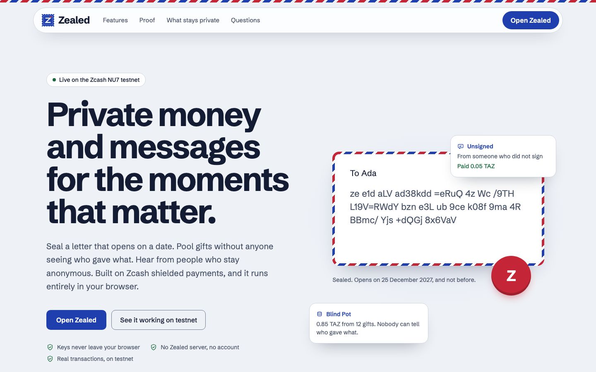
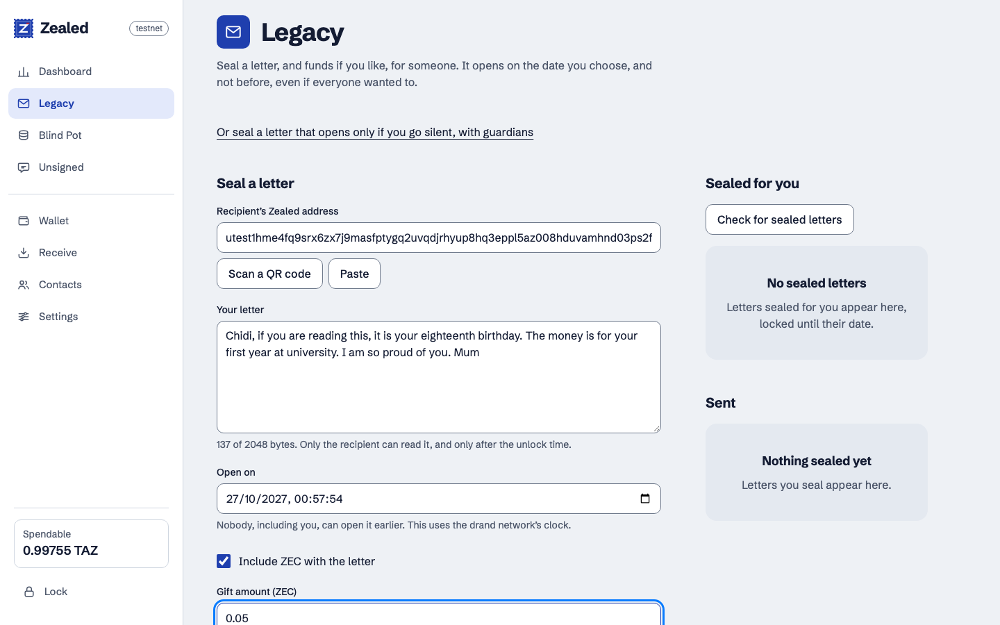
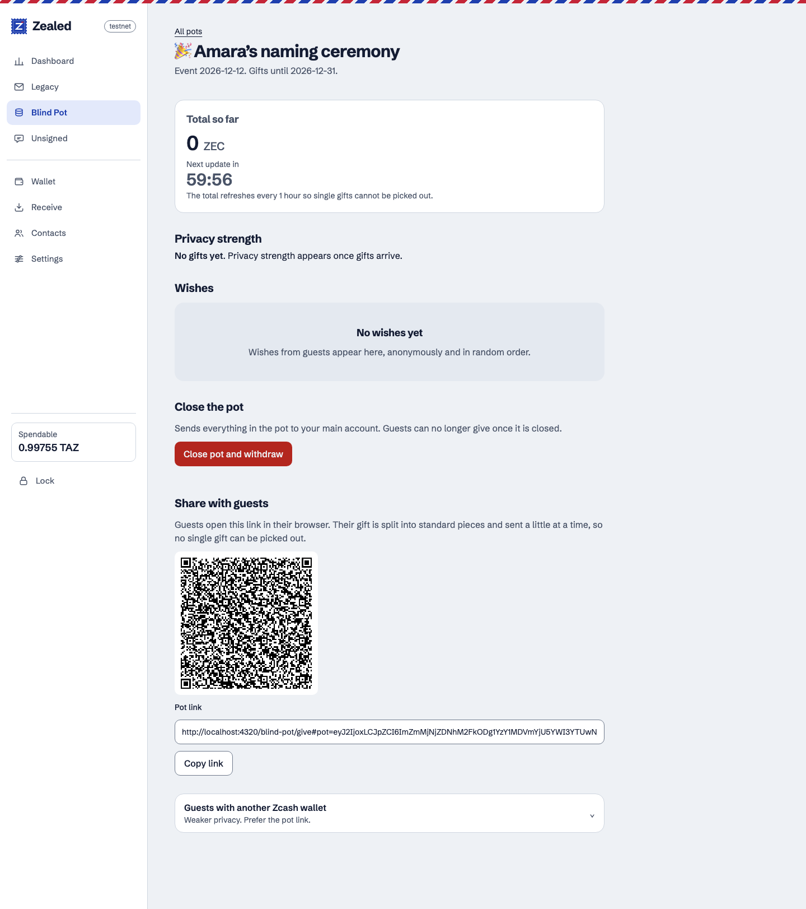
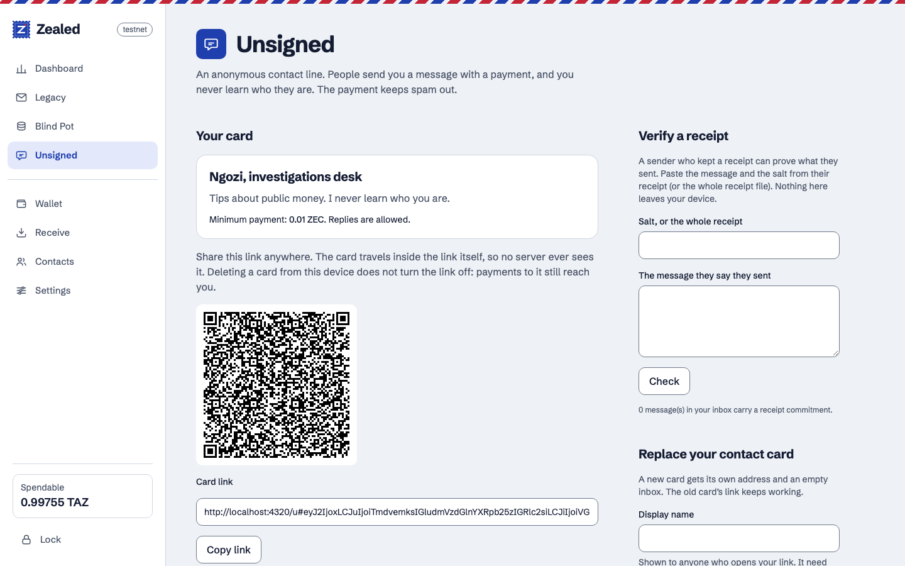
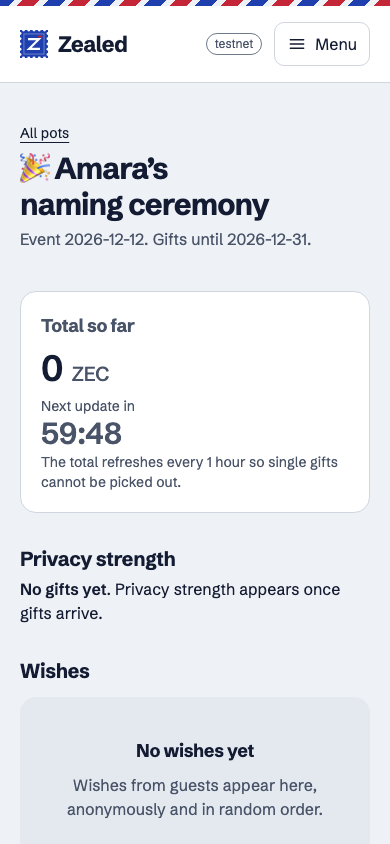
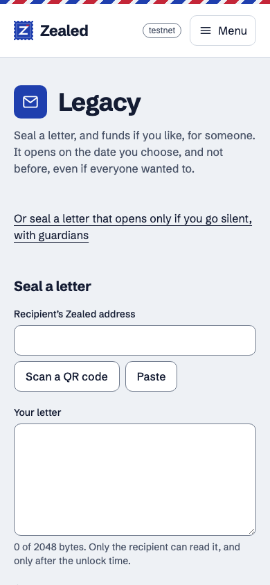
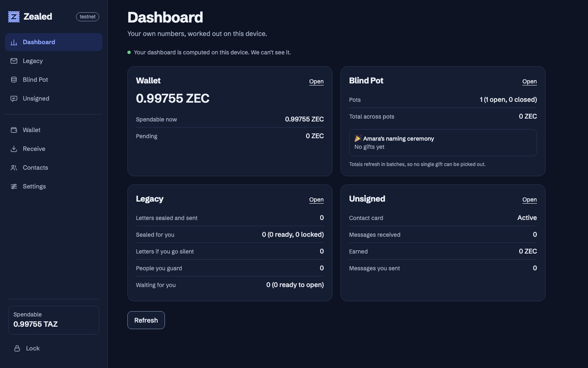

# Zealed

**Private money and messages for the moments that matter.**



Most Zcash apps ask why you would send shielded money. Zealed answers with reasons people already
have: a letter and an inheritance for someone you love, a gift pot where nobody sees who gave, and
a tip line where a source can reach a journalist and stay unknown. Each one is a moment where the
privacy of a shielded transaction is the point, not a side effect.

Zealed is a privacy-first progressive web app (PWA) built on Zcash. It lets people leave a sealed
letter and money for someone, collect gifts without exposing who gave, and receive anonymous
messages, all from the browser, with no application server holding anyone's data.

**ZECATHON track: Wildcard** ("anything that makes a shielded transaction worth making").

> **Network:** Zcash **testnet** (NU7) only. Zealed does not handle real funds.


## Table of contents

1. [Why Zealed exists](#why-zealed-exists)
2. [What Zealed does](#what-zealed-does)
3. [How it works](#how-it-works)
4. [Tech stack](#tech-stack)
5. [Getting started](#getting-started)
6. [Project structure](#project-structure)
7. [Privacy and security](#privacy-and-security)
8. [Project status](#project-status)
9. [Roadmap](#roadmap)
10. [Hackathon disclosure](#hackathon-disclosure)
11. [Acknowledgements](#acknowledgements)
12. [License](#license)


## Why Zealed exists

Money and messages between people are most fragile at the moments that matter most: when someone
dies, when a family gathers, when a community supports a cause, when a relative abroad sends help
home. In much of Africa, and in Nigeria in particular, the tools people have for these moments are
exposed, expensive, or controlled by someone else. Zealed started from six problems, and each one
is a reason to make a shielded transaction.

### 1. Inheritance issues and disputes

When someone dies without a clear, trusted way to pass things on, families fight. Wishes get
disputed, assets are held by whoever has the password, and heirs can be shut out entirely.
Digital assets make it worse: if no one else can reach the keys, the money is gone.

**Zealed's answer:** _Legacy_ lets a person seal a letter and money for a named heir. The heir
receives it directly, and nobody in the middle can read, redirect or quietly edit it.

### 2. Wills fraud and tampering

Forged, altered or "found" wills are a common source of conflict. The usual defence, trusting a
single lawyer, relative or registry, is itself the weak point.

**Zealed's answer:** a letter is encrypted and its contents are fixed at the moment it is sealed.
It reaches the heir as a record on the Zcash blockchain, so it cannot be swapped later by someone
with access to a drawer or a server. A silent-mode option spreads trust across several guardians
instead of one custodian.

> Zealed is **not** a legal will and does not replace one. It is a tamper-resistant way to deliver
> wishes and funds. Local law decides what is legally binding.

### 3. Donor exposure

Supporting a cause, a protest, a medical campaign or a family event can put the giver at risk:
retaliation, social pressure, or simply being targeted for more requests. Public fundraising
pages and bank transfers expose every donor and every amount.

**Zealed's answer:** _Blind Pot_. Guests contribute through a link or QR code, and the host sees
only the running total, never who gave or how much. Contributions are split into standard-size
pieces and spread out in time so amounts and timing are harder to match.

### 4. Government restrictions on crypto

Policies around crypto have swung between restriction and permission, and bank accounts linked to
protest funding or to crypto have been frozen or closed. People who rely on digital money need
tools that do not depend on a single institution's goodwill.

**Zealed's answer:** there is no Zealed server to shut down or subpoena. Everything runs in the
browser, funds are shielded, and the only external services are the public Zcash and drand
networks.

### 5. Expensive remittances for the diaspora

Sending money home is slow and costly. Fees on remittances to Africa are among the highest in the
world, and a transfer is just a number, with no room for a message, a condition or a date.

**Zealed's answer:** money and a message travel together, privately, directly to the recipient's
shielded address. A gift can also be locked until a chosen date, such as a school-fees deadline or
a birthday.

### 6. Surveillance and journalism under pressure

Journalists, investigators and creators need a way for people to reach them without being
identified, and without a platform storing the messages.

**Zealed's answer:** _Unsigned_ is an anonymous contact line. The sender stays anonymous, can
attach money to prove they are serious, and spam is priced out. No server holds the messages.


## What Zealed does

Three things, each one a moment where a shielded payment is the point rather than a side effect.

### Legacy: a letter that opens on its day



For a parent, a relative abroad, anyone whose words and money should arrive at the right moment and
not before.

- **Open on a date.** The letter is encrypted to a future round of the drand network. Nobody can
  open it early: not the recipient, not a server, not you.
- **Open if I go silent.** Guardians each hold a share of the key and release it only if you stop
  checking in.
- **What stays private:** the letter, until its day. The gift, from everyone but the recipient.

### Blind Pot: everyone gives, nobody is exposed



For weddings, naming ceremonies, funerals and community causes, where who gave and how much is
nobody's business.

- Guests give through a link or QR code, with a wish if they like. Each gift is split into
  standard-size pieces sent at different times, and the host's total refreshes only in batches.
- **Co-hosts** (optional): the pot's key is made by the co-hosts together, and any withdrawal needs
  k of n to sign (FROST threshold signatures). No one, the host included, can take the money alone.
  A withdrawal can take everything or a chosen amount, with the rest staying in the pot; every
  co-host reads what it actually does from the transaction itself before approving.
- **What stays private:** who gave, and how much. The host sees the total and the wishes.

### Unsigned: a contact line that never learns who called



For journalists, investigators and anyone who needs to be reachable without making their sources
reachable too.

- Publish a card as a link. People send a message with a small payment, which prices out spam, and
  you reply from what arrived.
- The card travels inside the link itself, so no server ever holds it or the messages.
- **What stays private:** the sender, always. Even you never learn who wrote.

### Around them

| Part              | What it does                                                                        | What stays private                     |
| ----------------- | ------------------------------------------------------------------------------------ | --------------------------------------- |
| **Wallet**         | A real Zcash wallet in the browser, as WebAssembly: create or restore, sync, send    | Keys never leave the device             |
| **Notifications**  | Co-host invitations and approvals, sealed letters, guardian events and anonymous messages, gathered in one place with a link to where each is handled | Worked out on the device from your own wallet; nothing is sent to see it |
| **Dashboard**      | Your own numbers, worked out on the device                                          | Nothing leaves the browser              |
| **Contacts**       | Names for addresses, shared as a link or through the phone's share sheet            | Contact data rides in the URL fragment  |
| **Languages**      | English, Spanish and French                                                         |                                          |

### On a phone, and after dark

|                                                                     |                                                                     |                                                                                                                                     |
| ------------------------------------------------------------------- | ------------------------------------------------------------------- | ----------------------------------------------------------------------------------------------------------------------------------- |
|  |  |  |

The design follows airmail: letter paper, fountain-pen navy, and the red-and-blue edge of an
envelope sent a long way. It installs as a PWA, its automated accessibility checks (axe, WCAG AA)
pass in both themes, and phone layouts are tested at 360 pixels wide.

## How it works

There is **no application backend.** Everything runs in the browser.

```
Browser (PWA)
 ├─ UI                React + TypeScript
 ├─ Wallet            Zcash (WebZjs, Rust compiled to WebAssembly), syncing in a Web Worker
 │    └─ gRPC-web ──► public Zcash light-wallet endpoint (testnet)
 ├─ Memo protocol     Zealed Memo Protocol (ZMP): chunks app messages into 512-byte Zcash memos
 ├─ Crypto            AES-256-GCM, drand time-lock encryption, Shamir secret sharing, Ed25519
 │    └─ drand ─────► public drand API (time-lock keys released on schedule)
 └─ Storage           Encrypted vault in the browser, key derived from the user's passphrase
```

The only servers involved are the public Zcash light-wallet endpoint and the public drand
network. All allowed network destinations are listed in one place (`src/config/network.ts`) and
enforced by a Content Security Policy.


## Tech stack

| Area           | Choice                                                                       |
| -------------- | ---------------------------------------------------------------------------- |
| App            | Vite, React 19, TypeScript (strict), React Router, Zustand, Tailwind CSS     |
| Zcash wallet   | WebZjs, patched for the NU7 testnet, built to WebAssembly (`wallet/`)        |
| Threshold keys | FROST (`reddsa`, `frost-rerandomized`) in the wallet, for Blind Pot co-hosts |
| Time-lock      | `tlock-js` with the drand quicknet                                           |
| Secret sharing | `shamir-secret-sharing`                                                      |
| Signatures     | `@noble/curves` (Ed25519)                                                    |
| QR codes       | `qrcode` (generate), `jsqr` (scan)                                           |
| Tests          | Vitest (unit and UI), Playwright (end to end)                                |
| Tooling        | ESLint (strict), Prettier, GitHub Actions                                    |


## Getting started

### Prerequisites

- Node.js 22.12 or newer (`.nvmrc` pins 24)
- npm
- To rebuild the wallet from source only: `rustup`, `wasm-pack`, and a clang that can target
  WebAssembly. See [wallet/README.md](wallet/README.md).

### Install and run

```sh
npm install
npm run dev
```

Open the address Vite prints. The landing page is at `/`, the app at `/app`.

The built WebAssembly wallet (about 60 MB) is in the repository at `public/wallet`, so
`npm install && npm run dev` works as is. You only need `npm run wallet:build` (about 10 minutes the
first time; see [wallet/README.md](wallet/README.md) for the tools it needs) if you change the Rust.

### Deploy

`npm run build` makes the app in `dist/`, and `npm start` serves it on `$PORT` with the security
headers and cross-origin isolation the wallet needs (`server/server.mjs`, no dependencies). On
Render, `render.yaml` sets this up as a web service. Browser data (wallet, letters, pots) lives in
each visitor's browser, so a new address starts empty: restore a wallet there from its 24 words.

### Demo mode

Real timers are hours and days. Add `?demo=1` to any URL (or use the toggle in Settings) to shorten
batching delays, unlock dates and check-in periods so every flow can be tried in minutes. Use
`?demo=0` to turn it off.

### Scripts

| Command                | What it does                        |
| ---------------------- | ----------------------------------- |
| `npm run dev`          | Start the development server        |
| `npm run build`        | Type-check and build for production |
| `npm run preview`      | Serve the production build locally  |
| `npm test`             | Run unit and UI tests (Vitest)      |
| `npm run test:e2e`     | Run end-to-end tests (Playwright)   |
| `npm run lint`         | Lint with ESLint                    |
| `npm run typecheck`    | Type-check with TypeScript          |
| `npm run format`       | Format with Prettier                |
| `npm run wallet:build` | Rebuild the WebAssembly wallet      |

### Getting testnet funds

Create a wallet on the **Wallet** page, copy your address from **Receive**, and request test coins
(TAZ) from a Zcash testnet faucet. Testnet coins have no value.


## Project structure

```
src/
  app/          Shell, routes and the landing page
  features/     Legacy, Blind Pot, Unsigned, Dashboard, Contacts, Receive, Settings
  wallet/       Browser wallet runtime and WebAssembly loader
  crypto/       Encryption, time-lock, secret sharing, signatures (with tests)
  zmp/          Zealed Memo Protocol (chunking app messages into memos)
  storage/      Encrypted vault, lock screen, auto-lock
  i18n/         English, Spanish, French
  config/       Network allow-list, timers, security headers
wallet/         Rust sources and patches for the WebAssembly wallet
tests/e2e/      Playwright tests
media/          README screenshots and artwork
```


## Privacy and security

- **No backend, no analytics, no third-party scripts, fonts or CDNs.** All assets are served by the
  app itself.
- **Strict Content Security Policy.** The only outbound destinations are the Zcash light-wallet
  endpoint and drand.
- **Encrypted vault.** Wallet data, contacts and history are stored encrypted in the browser with
  a key derived from a passphrase (PBKDF2, AES-256-GCM). The key is held only in memory and the
  vault locks after a period of inactivity.
- **Nothing sensitive in logs.** Seed phrases, keys, memos, amounts and addresses are never logged.
- **Shareable data lives in the URL fragment** (`#...`), which browsers never send to a server.
- **Well-known libraries only.** No home-made cryptographic primitives.

### Limits you should know about

- A forgotten passphrase **cannot be recovered**. The only way forward is to wipe the device and
  restore the wallet from the 24-word recovery phrase. Funds come back; local data such as
  contacts and sent history does not.
- Clearing browser data deletes the local wallet. Back up the recovery phrase.
- In "if I go silent" mode, guardians act when they open the app; browsers cannot run Zealed in
  the background. If an heir and enough guardians collude, they can open a letter early.
- Co-hosts need Zealed wallets with a little test money, and must open the app for their part of a
  withdrawal (browsers cannot run Zealed in the background). Lose too many co-hosts and the pot's
  money cannot move. A pot with co-hosts shows its total to every co-host.
- A Blind Pot paid from an outside wallet in a single payment has weaker privacy than one given
  through Zealed.
- The light-wallet server cannot read amounts, addresses or memos, but it does see your IP
  address, the block range you sync (which hints at when the wallet was created), which of your
  transactions you fetch to read their memos, and which transactions you send. Using Tor or a
  light-wallet server you run yourself reduces this; the endpoint is set in `src/config/network.ts`.
- Zealed cannot protect against a compromised browser, device or extension.


## Project status

| Area                                              | Status                                                                                                                                 |
| ------------------------------------------------- | -------------------------------------------------------------------------------------------------------------------------------------- |
| Browser wallet on the NU7 testnet                 | Real: sync, receive, send with memos                                                                                                   |
| Legacy (open on a date)                           | Real, tested end to end between two wallets on testnet                                                                                 |
| Legacy (open if I go silent)                      | Built; guardians act only when the app is opened                                                                                       |
| Blind Pot                                         | Real, tested end to end between two wallets on testnet                                                                                 |
| Blind Pot with co-hosts (FROST, k of n)           | Real: key made together over memos, withdrawal signed by the co-hosts, for everything or a chosen amount; tested in the browser (2 of 2) and natively (2 of 3) on testnet |
| Unsigned                                          | Real, tested end to end between two wallets on testnet                                                                                 |
| Notifications                                     | Built: a background check gathers co-host, letter, guardian and message events while the app is open                                 |
| Dashboard, Contacts, Receive, Settings, languages | Built                                                                                                                                  |
| Mainnet                                           | Not supported                                                                                                                          |

Timelock keys come from the live drand network. Timers are shortened only in demo mode.


## Roadmap

Ideas that follow from the problems above, in rough order:

1. **Encrypted backup** of contacts and history so wiping a device does not lose them.
2. **Human-readable names** for addresses through a memo-based registry, designed to avoid
   linking a public name to a single address.
3. **Less exposure to the light-wallet server:** fetch decoy transactions alongside real ones,
   send through a different connection than the one used to sync.
4. **Mainnet**, after an independent security review.


## Hackathon disclosure

Zealed is a submission to **ZECATHON** (window: 28 September to 28 October 2026) in the
**Wildcard** track.

- **Existed before the window:** the open-source libraries Zealed builds on, including WebZjs and
  the Zcash Rust crates, `tlock-js`, drand, and the packages listed in `package.json`.
- **Written during the window:** the Zealed application, its three features, the memo protocol, the
  encrypted vault, the patches that make the WebZjs wallet work on the NU7 testnet, and the FROST
  co-host signing for Blind Pot (built on the `reddsa` and `frost-rerandomized` crates).
- **Real versus simulated:** the wallet, transactions, memos and time-locks are real on the Zcash
  testnet and the live drand network. Demo mode only shortens timers. No transaction is faked.


## Acknowledgements

- [WebZjs](https://github.com/ZcashCommunityGrants/WebZjs) and the Zcash Community Grants and
  red.dev teams for the browser wallet
- [drand](https://drand.love) and `tlock-js` for time-lock encryption
- The Zcash Foundation and Electric Coin Company ecosystem, and the ZECATHON organisers


## License

Zealed is released under the [MIT License](LICENSE).

The WebAssembly wallet in `wallet/` is derived from [WebZjs](https://github.com/ZcashCommunityGrants/WebZjs) and keeps its own licenses (Apache-2.0 and MIT, see `wallet/LICENSE-APACHE` and `wallet/LICENSE-MIT`).
